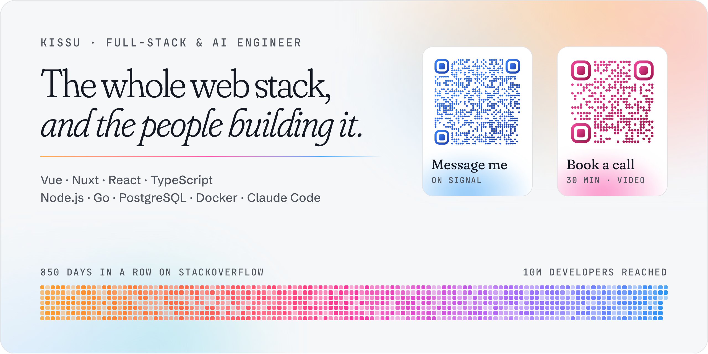

## Hey 👋🏻, I'm kissu 🐳

<a href="https://kissu.works">
  <picture>
    <source media="(prefers-color-scheme: dark)" srcset="./assets/banner-dark.png">
    
  </picture>
</a>

I've been building for the web for about ten years now, from the pixels all the way down to the server they run on. Vue and Nuxt are home 💚, but you'll also find me in React, TypeScript, Node.js, Go and a fair amount of Docker, lately for teams like ABN AMRO, Miele X, Nordhealth and RAIN Magazine.

- 🤖 **AI-first, responsibly**: agents write a good chunk of my code these days (Claude Code, custom skills, MCP servers), but I review every line and own every decision.
- 🙌 **Answering questions** on [Stack Overflow](https://stackoverflow.com/users/8816585/kissu), 850 days in a row at one point, mostly Vue and Nuxt. Around 10M developers reached so far.
- 🎤 **On stage** more than 30 times: talks, MC'ing, organizing PragVue and the Vue.js Rocks meetup, and GitNation's conference committee.
- 💜 **Giving back:** Nuxt ambassador, Women Techmakers ambassador, mentoring since 2018, and a couple of years teaching at Le Wagon Amsterdam.
- 🏠 **After hours:** a homelab running my own LLMs, split keyboards I solder myself, and a camera never too far away.

💬 Fancy a chat? [Ping me on Signal](https://signal.me/#eu/SrX1SfNvIFOHYoGmMEt22-WfaKig__THnjErkenmr87NXXwAKFhOqpKPKqyZBxKV), [grab a slot in my calendar](https://book.kissu.works/u/kissu), or scan the codes above.  
More about me on [kissu.works](https://kissu.works).
